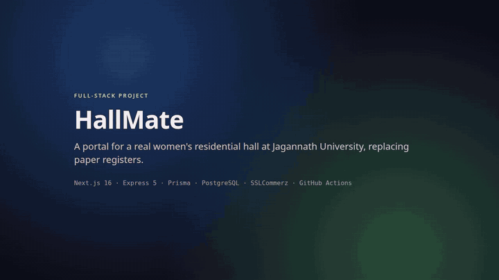
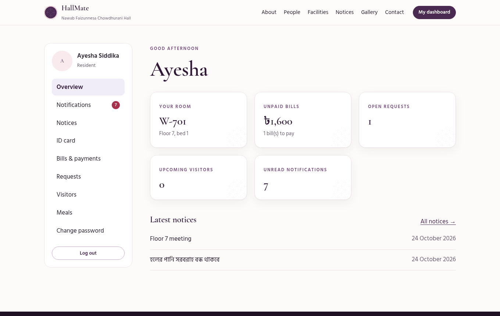
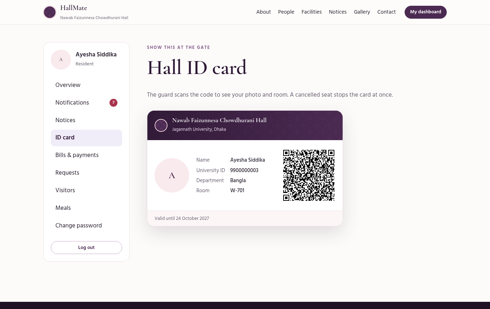
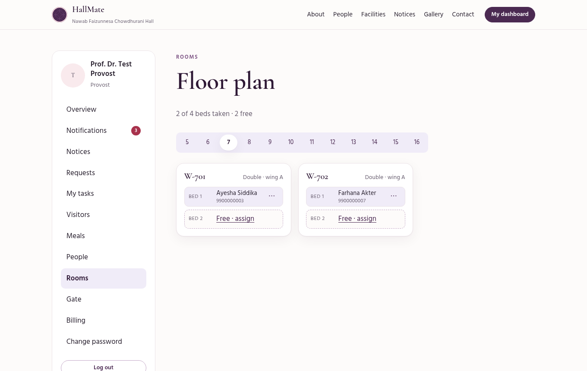
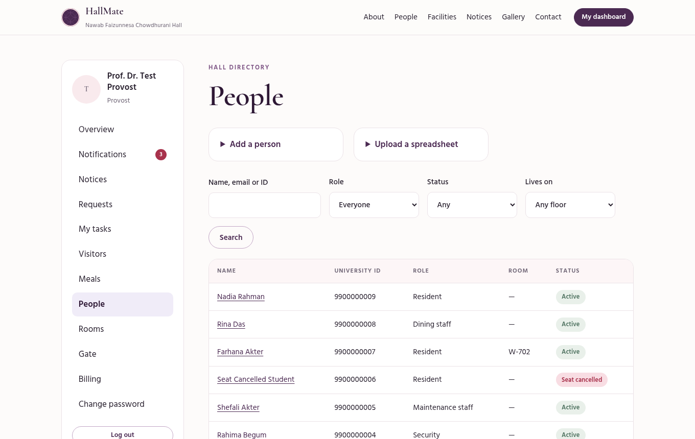
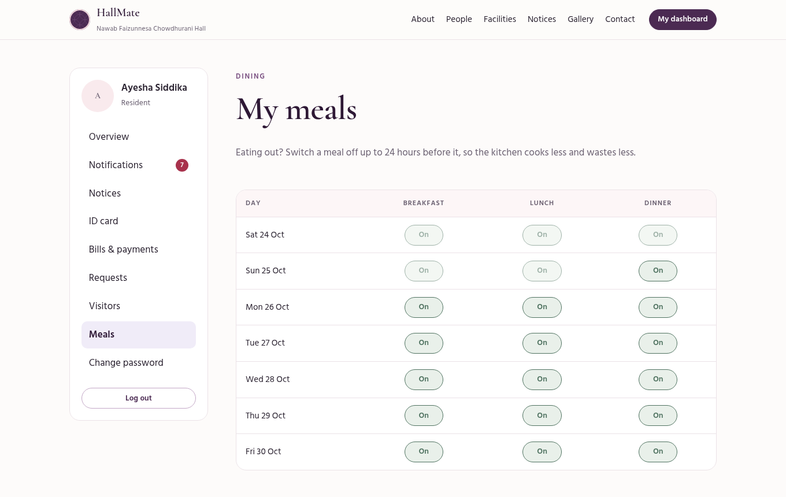
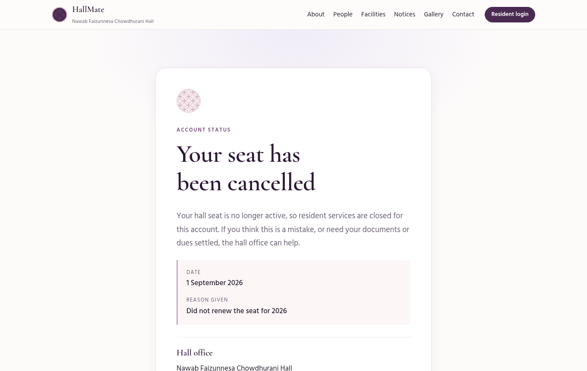
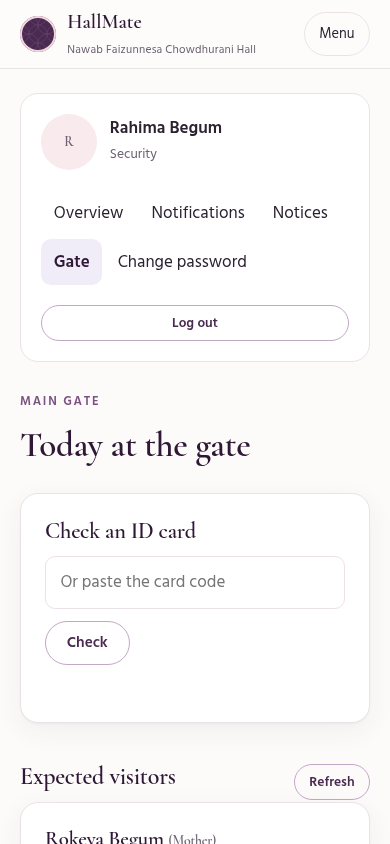
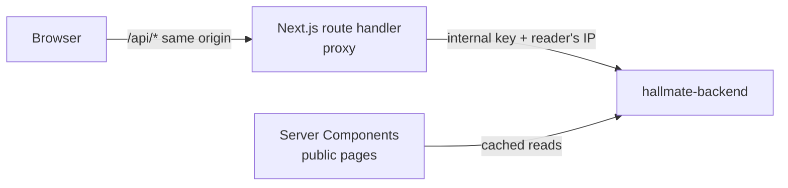

# HallMate Web

The website and resident portal for **Nawab Faizunnesa Chowdhurani Hall**, the women's residential hall of Jagannath University, Dhaka. A public site for the hall, and one sign-in that gives every resident and staff member a dashboard shaped to their job.

**Stack:** Next.js 16 (App Router) · React 19 · TypeScript · plain CSS with design tokens · no UI library · no tracking
**Live:** [hallmate.vercel.app](https://hallmate.vercel.app) · **Try every role:** [demo accounts](https://github.com/rifah07/hallmate-backend/blob/master/docs/DEMO_ACCOUNTS.md) (read-only) · **API:** [hallmate-backend](https://github.com/rifah07/hallmate-backend) (Express 5, Prisma, PostgreSQL)

[](docs/demo.mp4)

▶ **[Watch the 2-minute demo with captions](docs/demo.mp4)**: the public site, then a resident's ID card, bills and visitors, the administrator's people, floor plan and billing, and the guard at the gate.

| Resident dashboard | Digital ID card |
|---|---|
|  |  |
| **Provost: floor plan** | **Provost: people** |
|  |  |
| **Meals, a week ahead** | **A cancelled seat, explained** |
|  |  |

<p align="center"></p>

_Screenshots use sample data._

---

## Highlights

- **One portal, ten roles.** Each role sees only the pages its job needs; the API enforces the same rules, so hiding a link is never the only protection.
- **Built for a women's hall.** Support staff never see residents' phones, rooms or lists; a house tutor sees only the students on her floor; the guard sees a visitor's name and relation, never a phone number.
- **Secure sessions without a library.** Access token in memory only, HttpOnly refresh cookie through a same-origin proxy, one shared refresh so rotating tokens never collide, strict CSP.
- **Works on a phone at the gate.** The guard scans ID cards with the phone camera (native `BarcodeDetector`, no library) and checks visitors in and out.

## What each role gets

| Role | Pages |
|---|---|
| Resident | Room and roommates, digital ID card with QR, bills with online payment (bKash, Nagad, Rocket, cards via SSLCommerz), meals she can switch off a day ahead, requests (complaint, repair, leave, room change, bed swap with her friend's consent, giving up her seat), visitor pre-registration, notices, notifications |
| House tutor | Her floor only: its students and rooms, requests to decide, visitors to approve, floor notices |
| Provost and admin | The whole hall: people (add one, upload a spreadsheet, account status including seat cancellation, one-time passwords), floor plan with assign, move and remove, requests with bed allocation, assigning repairs, renewal billing and cash payments, notices |
| Guard | ID card scanning, today's visitors with check-in and check-out |
| Dining staff | How many breakfasts, lunches and dinners to cook on a given day |
| Support staff | The repairs assigned to them, and notices |

The public site has about the hall, achievements, events, the provost and every former provost, house tutors with their floors, the hall office, facilities, dining, gallery, admission with online applications and tracking, notices with PDFs, an FAQ and a contact form, all read live from the API (Bangla content, English interface). Sample content is badged "Sample", and no photos of real people are used: profiles show an initial until the hall uploads a photo.

## Architecture



| Piece | File | Why |
|---|---|---|
| Same-origin proxy | `src/app/api/[...path]/route.ts` | The refresh cookie lives on this site's domain (`SameSite=Strict`); the API rate-limits per reader instead of per Vercel IP; only allow-listed headers pass |
| Public pages | `src/app/*/page.tsx`, `src/lib/public-api.ts` | Server-rendered and refreshed at most every 5 minutes; if the API is down a page shows a calm message instead of failing |
| Client API | `src/lib/client-api.ts` | Token header, one refresh and one retry on 401, readable error messages, authenticated downloads |
| Session | `src/lib/session.tsx` | Who is signed in; a blocked account is signed out and sent to its own page |
| Dashboards | `src/app/dashboard/*` | One page per job; the layout builds the navigation from the role |
| Forms | `src/components/Form.tsx` | One accessible form for every page: browser validation first, the API's message second, announced with `aria-live` |

## Security

| Risk | What the code does |
|---|---|
| Token theft by injected script | The access token never touches `localStorage`; strict CSP (`next.config.ts`) with no third-party scripts |
| CSRF | Refresh cookie is `HttpOnly`, `SameSite=Strict`, scoped to `/api/auth`, sent only to this origin |
| Open redirect | `?next=` after login accepts only same-site paths (`src/lib/safe-next.ts`, tested) |
| Fake payment page | The browser is sent only to `https://*.sslcommerz.com` (`src/lib/billing.ts`, tested); a bill counts as paid only after the API verifies it with the gateway |
| Blocked accounts | Any `ACCOUNT_*` error signs the user out and opens `/account-status`, e.g. "Your seat has been cancelled" with the reason, date and hall office contact |
| XSS through the QR code | The card's SVG is shown as an `` data URI, never injected as markup |
| Leaked one-time passwords | Shown only when email failed, only to the provost, only once |

## Design

Plum, blush, lavender, sage and teal, with no yellow or orange; a carved-stone *jali* lattice as the motif; Cormorant Garamond with Hind Siliguri and Noto Serif Bengali so Bangla and English sit together. Colours are chosen for WCAG AA contrast, every page works at 360 px wide without sideways scrolling, motion respects `prefers-reduced-motion`, and the ID card and one-time-password sheet print cleanly.

## Run locally

Start [hallmate-backend](https://github.com/rifah07/hallmate-backend) on port 5000 first.

```bash
npm install
cp .env.example .env.local   # BACKEND_URL, and the same INTERNAL_API_KEY as the API
npm run dev                  # http://localhost:3000
```

| Command | What it does |
|---|---|
| `npm run dev` | Dev server |
| `npm run typecheck` | Route types and TypeScript |
| `npm run lint` | ESLint |
| `npm test` | Unit tests for the security helpers and request mapping (`node --test`, no extra dependencies) |
| `npm run build` | Production build |

## Decisions

| Choice | Why |
|---|---|
| Polling every 30 seconds, not websockets | Vercel functions can't hold sockets; polling pauses while the tab is hidden |
| Plain CSS, no Tailwind or UI kit | A small, distinctive design system that can be read end to end |
| Native `BarcodeDetector` for the guard | Built into Chrome on Android; other browsers paste the code |
| One-time passwords can appear on the provost's screen | Until an email domain is verified, email can't reach residents; the code is handed over in person instead of being lost |
| A bed swap names the friend by university ID | Students can't see other residents' records; the API finds the rooms and the friend agrees from her own account |

## Status

Live at [hallmate.vercel.app](https://hallmate.vercel.app). Next: a verified email domain so residents receive their codes by email.

## Author

**Rifah Sajida Deya** · [GitHub](https://github.com/rifah07)
